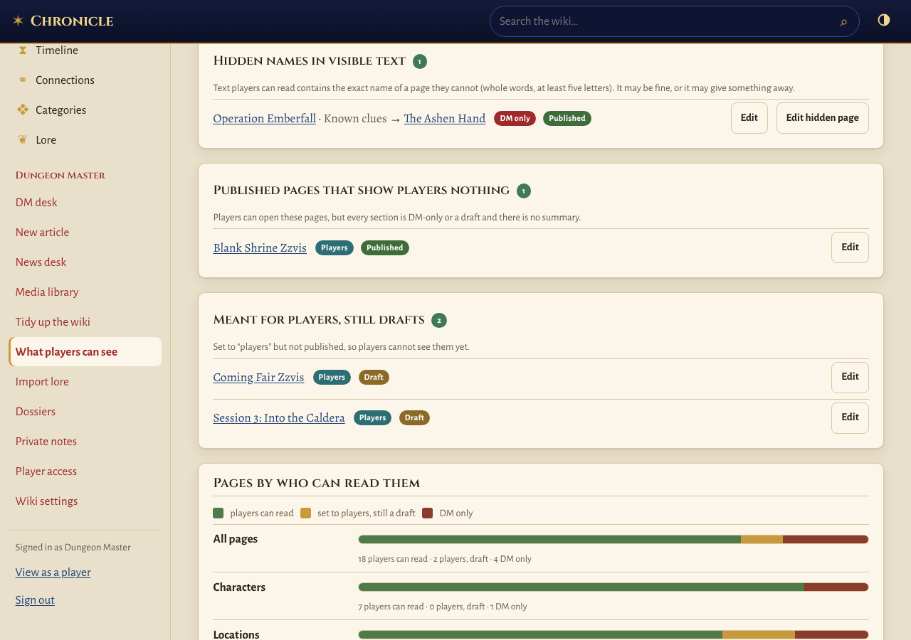
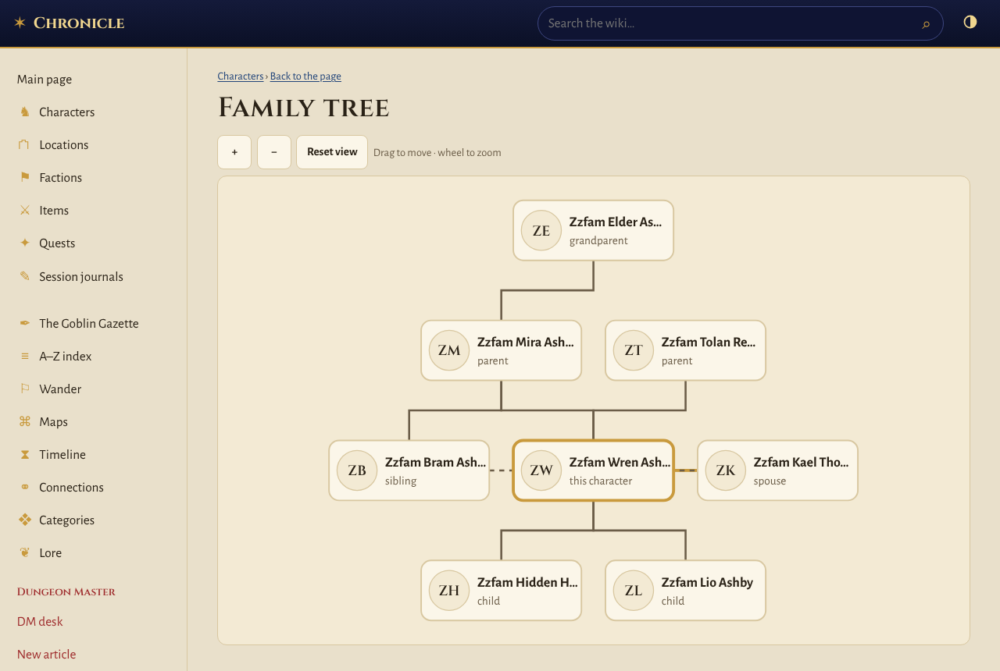
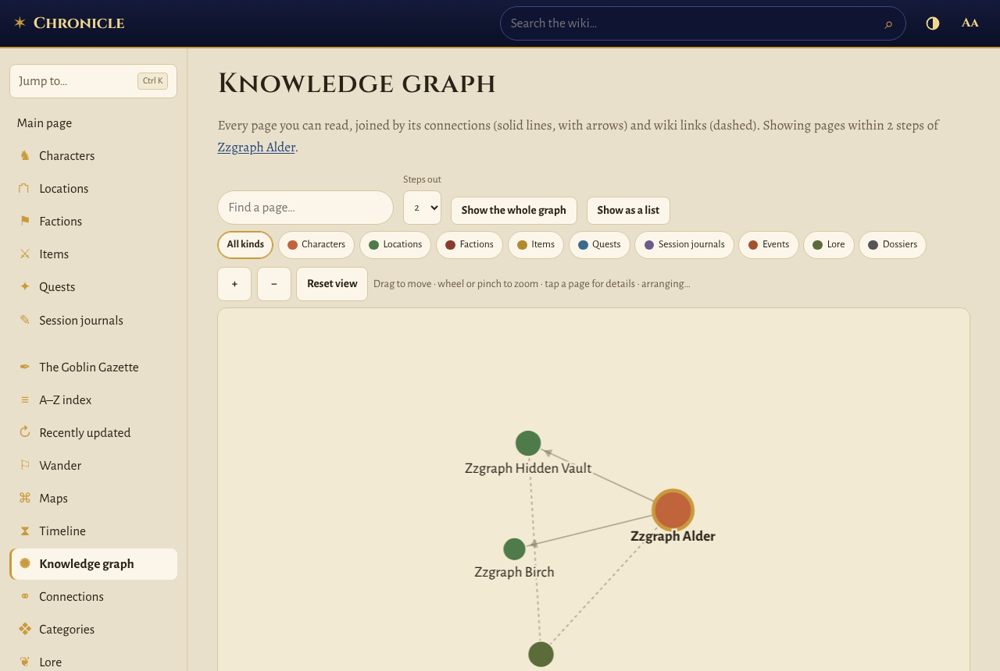
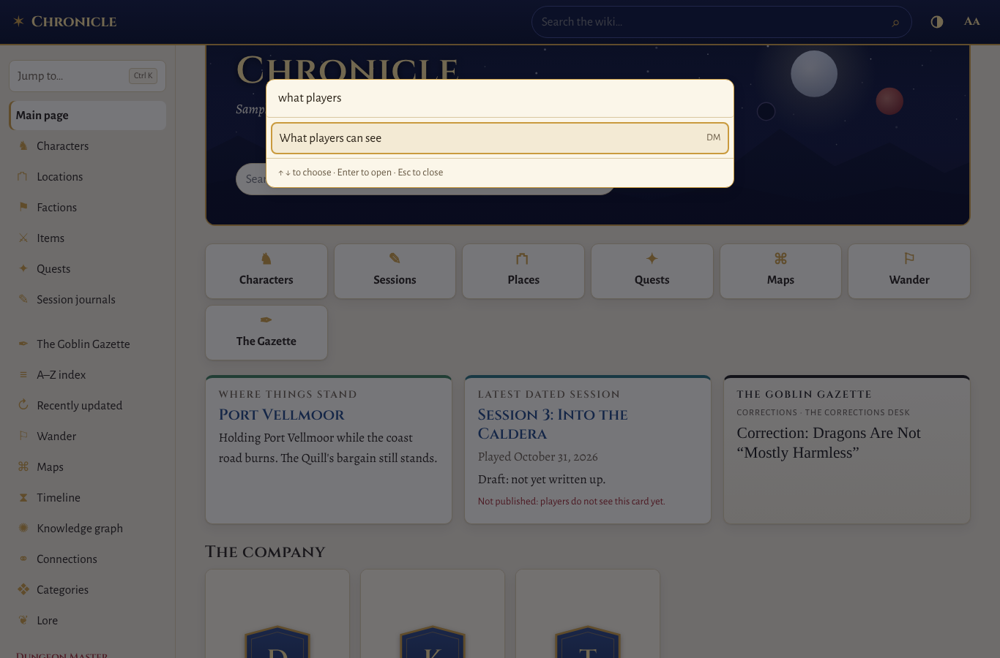
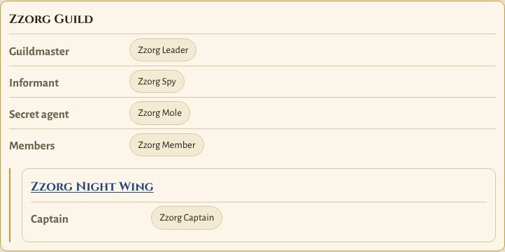
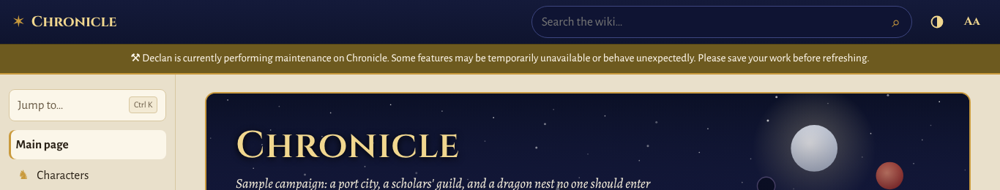

# Chronicle website features (November 2026 sprint)

This page explains two features added during the November 2026 sprint: the picture viewer, which everyone can use, and the wiki tidy-up report, which only the DM can open.

## A. Picture viewer (players and DM)

On any wiki page, click a picture (or press Enter while it is selected) to open it full screen.

- **Moving between pictures:** the viewer steps through every picture on that page, in order. Use the Previous and Next buttons, the Left and Right arrow keys, or swipe on a phone.
- **What you see:** a counter such as "3 of 7", the caption, and the description (the alt text).
- **Open original:** opens the full-size file in a new tab.
- **Closing:** press Esc, press Close, or click outside the picture. You return to the picture you opened.
- **Only visible pictures:** the viewer includes only the pictures you can already see on the page. A player never sees a DM-only picture, and it is not counted in the "of" total.
- **Phones:** Previous and Next sit under the picture.

**Limitation:** a picture link expires after 10 minutes. If the viewer stays open that long, close it and open it again.

### Tests

- **Picture viewer, unit:** 4 tests in `src/lib/lightbox.test.ts`.
- **Picture viewer, browser:** `tests/e2e/lightbox.spec.ts` covers:
  - opening by click and by Enter;
  - the Previous and Next buttons;
  - the arrow keys and wrap-around;
  - Esc and Close, and focus returning to the picture;
  - the phone layout and touch swipe;
  - a player never seeing a DM-only picture.
- **Full-suite results:** see IMPLEMENTATION-STATUS.md

## B. Tidy up the wiki (DM only)

Open the DM desk and choose **Tidy up the wiki**, or go to `/dm/tidy`. The report shows five collapsible lists, each with a count:

1. **Broken links:** a wiki link to a page that does not exist and is not a redirect. "Create this page" opens the new-page form with the address and title already filled in.
2. **Pages nothing links to:** pages with no link from another page and no connection to anything. Sessions and Gazette stories are not listed.
3. **Missing summary:** pages with no summary.
4. **Missing picture:** characters, locations and factions with no main picture.
5. **Empty pages:** pages with no section that contains text.

Each row links to the page and to its editor, and shows whether players can see the page.

- **Only pages players can see:** narrows every list to published player pages.
- **Gazette stories:** left out of the report. Edit them on the news desk.
- **Read only:** the report changes nothing.
- **Players:** cannot open it.

### Tests

- **Unit tests:** `src/lib/wikiTidy.test.ts`.
- **Browser tests:** `tests/e2e/wiki-tidy.spec.ts` (2 tests). They cover the DM report, the filters, the create-page prefill, and the phone layout. A player sees nothing.
- **Full-suite results:** see IMPLEMENTATION-STATUS.md

## Technical notes

- No database migrations and no new dependencies.
- The picture viewer uses a native dialog. It registers only pictures whose signed link loaded.
- The tidy report loads ids and slugs in parallel paged queries. It never downloads section text.
- The new-page form accepts `?slug=` and `?title=` to prefill a draft. Nothing is saved until the DM saves.

---

# Second sprint (2026-11-16)

No database migrations; no new dependencies. Everything players see still comes only from what
Row Level Security lets them read.

## C. Place chips (everyone)
Article pages show chips for the places a page is connected to, and "On map: …" chips that open
the map centred on the pin (`/maps/<map>?marker=<id>`). A hidden place, pin or map never becomes a
chip for a player.

## D. Wander (everyone)
"Wander" in the menu (and on the home page) opens a random page you can read, avoiding the last ten
you wandered to. `/wander?type=character` wanders among one kind only.

## E. A–Z index (everyone)
`/a-z`: every page you can read by first letter, with a title search and a kind filter. The address
keeps your choices (`?letter=B&type=location&q=…`), so a view can be shared.

## F. Tidy up the wiki: stubs and to-dos (DM)
The tidy report also lists **stubs** (a little text but no substantial section), sorts each list,
filters by kind, and shows a summary strip. Pages with private DM notes are marked; a note titled
"To do …" is shown as a to-do.

## G. What players can see (DM)
`/dm/visibility` (DM menu, DM desk, tidy report). Read-only.
- **Links to hidden pages**: text players can read links to a page they cannot (the link shows the
  hidden name).
- **Hidden names in visible text**: text players can read contains the exact name (whole words,
  five letters or more) of a page they cannot. Names that a readable page also uses are ignored.
- **Published pages that show players nothing** and **pages meant for players still in draft**.
- Totals by kind and category: readable by players / players but draft / DM only.
Each row links to the page and its editor. Nothing is changed for you.

## H. Family trees (everyone)
Connect characters with **Parent of**, **Spouse of** or **Sibling of** (Connections in the editor;
"Parent of" points from parent to child; on the child's page it reads "Child of"). A character
with family gets a **Family** panel; **Open the full family tree** goes to `/family/<character>`.
Drag to move, + / − or the wheel to zoom, **Reset view** to return. Every person is a link you can
reach with Tab; a text list under the tree repeats the family. Up to four generations each way;
"more" marks someone with family beyond that. A hidden character or connection is never drawn for
a player.

## I. Status ribbons (everyone)
A page's **Status** (or Condition) field shows as a ribbon when it describes a world state:
Deceased, Missing, Destroyed, Captured, Rumoured or Retired (for example "Slain at the Ford" →
Deceased). Shown on cards and under page titles. A Status field marked DM-only is never shown to
players. Other statuses stay plain text.

## J. Recently updated (everyone)
`/recent` lists pages that were published or had text added or changed, by day, with the headings
that changed. For players only text they can read counts, so a DM edit to hidden text never shows
up. Gazette stories stay on the news page.

## K. Renaming a page keeps old links working (DM)
Changing an existing page's address shows **Keep the old address working** (ticked). On save a
redirect is added. Players can use the old address only if they could read the page under it.

## L. Header and menu
- Phones: **Open search** in the header opens the menu with the search box ready.
- The phone menu: focus goes into it, Escape closes it, and the page behind can't be used while it
  is open.
- The theme control names its choices: match device, light, dark.
- Desktop: the menu stays in view while you scroll a long page.
- Touch screens: controls are at least 44px high.
- "Reduce motion" turns off animations and the card hover lift.

## Tests added this sprint
Unit:
- `visibilityAudit` (6), `familyTree` (4), `statusRibbon` (4), `recentChanges` (3);
- the agents' `placeChips`, `wander`, `azIndex` and `wikiTidy` additions.

Browser:
- `location-chips`, `wander`, `az-index`, `wiki-tidy` (stubs), `lightbox` (expired link);
- `dm-visibility`, `family-tree`, `status-ribbons`, `recent`, `rename-redirect`, `navigation`.

Every player-facing test checks that a hidden page, field or connection never reaches a player,
and most check every API response a player receives.

Documentation screenshots are written only with `SAVE_DOC_SHOTS=1`, for example
`SAVE_DOC_SHOTS=1 bash scripts/e2e-local.sh tests/e2e/family-tree.spec.ts`.

## Waiting for approval
Bookmarks, reading lists and personal notes need one new table each. The design is in
[PROPOSAL-MIGRATIONS.md](PROPOSAL-MIGRATIONS.md). Nothing has been written yet.

# Third sprint (2026-11-16, overnight)
No database migrations. Everything players see still comes only from what Row Level Security lets them read.

## M. Knowledge graph (everyone)
Open it from **Knowledge graph** in the menu, or with **Show in the knowledge graph** on a page
that has connections. Every page you can read is a dot: the colour is the kind, the size is the
number of lines. Connections are solid lines with arrows; wiki links are dashed.

- Drag the background to move, the wheel or pinch to zoom, drag a page to move it.
- Tap a page for a card: summary, picture, **Open the page**, **Centre the graph here**.
- Double-click a page to open it. **Reset view** fits everything.
- **Find a page…** highlights matches. Enter opens the first one.
- Kind buttons filter the graph. **Include unconnected pages** adds pages with no lines.
- **Steps out** (1–3) shows connections up to that many steps from the centred page.
- **Show as a list** gives the same pages and connections as text.

Filters stay in the address and are remembered on this browser. Large wikis (over 600 pages) are
arranged in the background. A page you cannot read never appears as a dot, a line, a name or a
count.

The kind filters start on **All kinds**. Choosing kinds narrows the graph; **All kinds** clears the choice. Screen readers hear which choice is on.

## N. Command palette (everyone)
Press Ctrl+K (Cmd+K on Mac) or "/" anywhere, or use **Jump to…** at the top of the menu.

- Type part of a page name or a part of the site, such as "Knowledge graph", "A–Z index",
  "Recently updated" or "Maps".
- Arrow keys choose, Enter opens. With no match, Enter searches everything.
- Escape closes it.

DM tools only appear for the DM.

## O. Search operators (everyone)
On the search page:
- `"quoted phrase"` finds the exact words.
- `-word` leaves a word out.
- `or` between two words finds either one.
- `type:character` (or `type:locations`, `type:session` and so on) limits results to one kind.
- `category:"Name"` limits results to one category.

The kind buttons show counts and narrow the results. **Search tips** on the page explains this.
Filters never show a page you could not already find.

## P. Reading comfort (everyone)
The **Aa** control next to the theme switch sets the text size: standard, larger text, or larger
text in a plain font. The choice is remembered on this browser. Article text keeps to a
comfortable line length on wide screens.

## Q. Faction organisation (everyone)
Faction pages show who belongs, grouped by the label on their **Member of** connection (for
example "Captain"). Leaders are listed first and plain members last. Groups appear within the
faction.

Tip for the DM: put the rank in the label of the connection.

## R. Recently updated, by kind (everyone)
`/recent` has kind buttons, so you can see only one kind of page (for example only characters).

## S. Status ribbons: Unknown and Inactive (everyone)
A Status of exactly "Unknown" or "Fate unknown" shows an **Unknown** ribbon. "Inactive" or
"Dormant" shows an **Inactive** ribbon. Inactive is separate from Retired.

## T. More leak checks (DM, What players can see)
The **What players can see** page also flags:
- hidden page names that appear in a visible page's summary or subtitle;
- DM-only pictures placed in text that players can read. Players see no picture, but the file
  name reaches them with the text;
- categories players can see whose pages are all hidden.

## U. Maintenance notice (everyone)
When maintenance is on, every page shows: "Declan is currently performing maintenance on Chronicle.
Some features may be temporarily unavailable or behave unexpectedly. Please save your work before
refreshing." Set-up and options: see [MAINTENANCE-NOTICE.md](MAINTENANCE-NOTICE.md). Not configured
on the live site yet.

## Waiting for approval (third sprint)
Bookmarks and reading lists, personal notes, the Investigation Board, the Mystery Studio, the
Feedback Center, personal invitations and Knowledge Studio collections each need new database
tables. Their designs are in [PROPOSAL-MIGRATIONS.md](PROPOSAL-MIGRATIONS.md); nothing has been
written.

## Tests added (third sprint)
Unit:
- `knowledgeGraph`, `commands`, `searchQuery`, `orgChart`, `status` (maintenance);
- additions to `visibilityAudit` and `statusRibbon`.

Browser:
- `graph` (3, including an 800-page layout);
- `palette` (2), `search-operators`, `org-chart`, `maintenance`;
- additions to `navigation` (reading comfort), `recent` (kind filter) and `dm-visibility`
  (categories).

Every player-facing test checks that hidden pages, fields and connections never reach a player.
