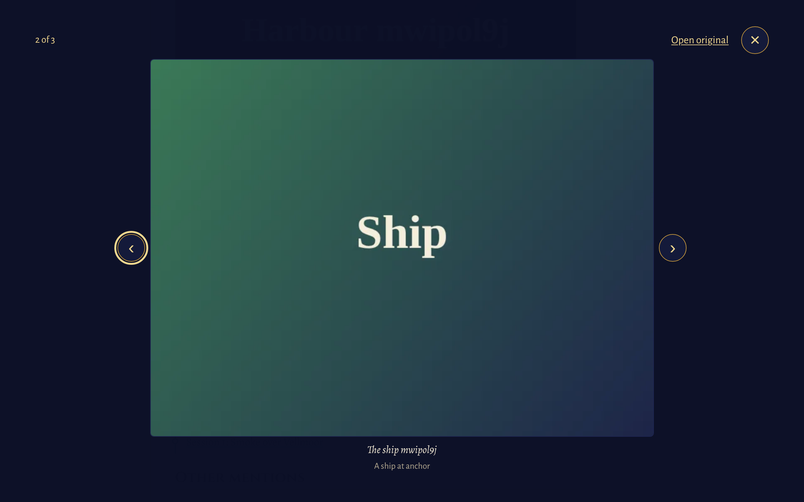
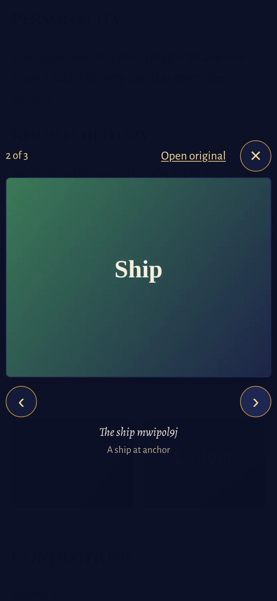
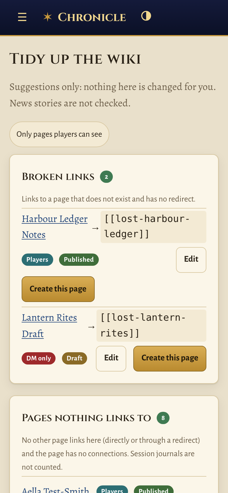

# Chronicle website features (November 2026 sprint)

This page explains two features added during the November 2026 sprint: the picture viewer, which everyone can use, and the wiki tidy-up report, which only the DM can open.

## A. Picture viewer (players and DM)

On any wiki page, click a picture (or press Enter while it is selected) to open it full screen.

- **Moving between pictures:** the viewer steps through every picture on that page, in order. Use the Previous and Next buttons, the Left and Right arrow keys, or swipe on a phone.
- **What you see:** a counter such as "3 of 7", the caption, and the description (the alt text).
- **Open original:** opens the full-size file in a new tab.
- **Closing:** press Esc, press Close, or click outside the picture. You return to the picture you opened.
- **Only visible pictures:** the viewer includes only the pictures you can already see on the page. A player never sees a DM-only picture, and it is not counted in the "of" total.
- **Phones:** Previous and Next sit under the picture.

**Limitation:** a picture link expires after 10 minutes. If the viewer stays open that long, close it and open it again.

### Tests

- **Picture viewer, unit:** 4 tests in `src/lib/lightbox.test.ts`.
- **Picture viewer, browser:** `tests/e2e/lightbox.spec.ts` covers:
  - opening by click and by Enter;
  - the Previous and Next buttons;
  - the arrow keys and wrap-around;
  - Esc and Close, and focus returning to the picture;
  - the phone layout and touch swipe;
  - a player never seeing a DM-only picture.
- **Full-suite results:** see IMPLEMENTATION-STATUS.md

## B. Tidy up the wiki (DM only)

Open the DM desk and choose **Tidy up the wiki**, or go to `/dm/tidy`. The report shows five collapsible lists, each with a count:

1. **Broken links:** a wiki link to a page that does not exist and is not a redirect. "Create this page" opens the new-page form with the address and title already filled in.
2. **Pages nothing links to:** pages with no link from another page and no connection to anything. Sessions and Gazette stories are not listed.
3. **Missing summary:** pages with no summary.
4. **Missing picture:** characters, locations and factions with no main picture.
5. **Empty pages:** pages with no section that contains text.

Each row links to the page and to its editor, and shows whether players can see the page.

- **Only pages players can see:** narrows every list to published player pages.
- **Gazette stories:** left out of the report. Edit them on the news desk.
- **Read only:** the report changes nothing.
- **Players:** cannot open it.

### Tests

- **Unit tests:** `src/lib/wikiTidy.test.ts`.
- **Browser tests:** `tests/e2e/wiki-tidy.spec.ts` (2 tests). They cover the DM report, the filters, the create-page prefill, and the phone layout. A player sees nothing.
- **Full-suite results:** see IMPLEMENTATION-STATUS.md

## Technical notes

- No database migrations and no new dependencies.
- The picture viewer uses a native dialog. It registers only pictures whose signed link loaded.
- The tidy report loads ids and slugs in parallel paged queries. It never downloads section text.
- The new-page form accepts `?slug=` and `?title=` to prefill a draft. Nothing is saved until the DM saves.

---

# Second sprint (2026-11-16)

No database migrations; no new dependencies. Everything players see still comes only from what
Row Level Security lets them read.

## C. Place chips (everyone)
Article pages show chips for the places a page is connected to, and "On map: …" chips that open
the map centred on the pin (`/maps/<map>?marker=<id>`). A hidden place, pin or map never becomes a
chip for a player.

## D. Wander (everyone)
"Wander" in the menu (and on the home page) opens a random page you can read, avoiding the last ten
you wandered to. `/wander?type=character` wanders among one kind only.

## E. A–Z index (everyone)
`/a-z`: every page you can read by first letter, with a title search and a kind filter. The address
keeps your choices (`?letter=B&type=location&q=…`), so a view can be shared.

## F. Tidy up the wiki: stubs and to-dos (DM)
The tidy report also lists **stubs** (a little text but no substantial section), sorts each list,
filters by kind, and shows a summary strip. Pages with private DM notes are marked; a note titled
"To do …" is shown as a to-do.

## G. What players can see (DM)
`/dm/visibility` (DM menu, DM desk, tidy report). Read-only.
- **Links to hidden pages**: text players can read links to a page they cannot (the link shows the
  hidden name).
- **Hidden names in visible text**: text players can read contains the exact name (whole words,
  five letters or more) of a page they cannot. Names that a readable page also uses are ignored.
- **Published pages that show players nothing** and **pages meant for players still in draft**.
- Totals by kind and category: readable by players / players but draft / DM only.
Each row links to the page and its editor. Nothing is changed for you.

## H. Family trees (everyone)
Connect characters with **Parent of**, **Spouse of** or **Sibling of** (Connections in the editor;
"Parent of" points from parent to child; on the child's page it reads "Child of"). A character
with family gets a **Family** panel; **Open the full family tree** goes to `/family/<character>`.
Drag to move, + / − or the wheel to zoom, **Reset view** to return. Every person is a link you can
reach with Tab; a text list under the tree repeats the family. Up to four generations each way;
"more" marks someone with family beyond that. A hidden character or connection is never drawn for
a player.

## I. Status ribbons (everyone)
A page's **Status** (or Condition) field shows as a ribbon when it describes a world state:
Deceased, Missing, Destroyed, Captured, Rumoured or Retired (for example "Slain at the Ford" →
Deceased). Shown on cards and under page titles. A Status field marked DM-only is never shown to
players. Other statuses stay plain text.

## J. Recently updated (everyone)
`/recent` lists pages that were published or had text added or changed, by day, with the headings
that changed. For players only text they can read counts, so a DM edit to hidden text never shows
up. Gazette stories stay on the news page.

## K. Renaming a page keeps old links working (DM)
Changing an existing page's address shows **Keep the old address working** (ticked). On save a
redirect is added. Players can use the old address only if they could read the page under it.

## L. Header and menu
- Phones: **Open search** in the header opens the menu with the search box ready.
- The phone menu: focus goes into it, Escape closes it, and the page behind can't be used while it
  is open.
- The theme control names its choices: match device, light, dark.
- Desktop: the menu stays in view while you scroll a long page.
- Touch screens: controls are at least 44px high.
- "Reduce motion" turns off animations and the card hover lift.

## Tests added this sprint
Unit:
- `visibilityAudit` (6), `familyTree` (4), `statusRibbon` (4), `recentChanges` (3);
- the agents' `placeChips`, `wander`, `azIndex` and `wikiTidy` additions.

Browser:
- `location-chips`, `wander`, `az-index`, `wiki-tidy` (stubs), `lightbox` (expired link);
- `dm-visibility`, `family-tree`, `status-ribbons`, `recent`, `rename-redirect`, `navigation`.

Every player-facing test checks that a hidden page, field or connection never reaches a player,
and most check every API response a player receives.

Documentation screenshots are written only with `SAVE_DOC_SHOTS=1`, for example
`SAVE_DOC_SHOTS=1 bash scripts/e2e-local.sh tests/e2e/family-tree.spec.ts`.

## Waiting for approval
Bookmarks, reading lists and personal notes need one new table each. The design is in
[PROPOSAL-MIGRATIONS.md](PROPOSAL-MIGRATIONS.md). Nothing has been written yet.

