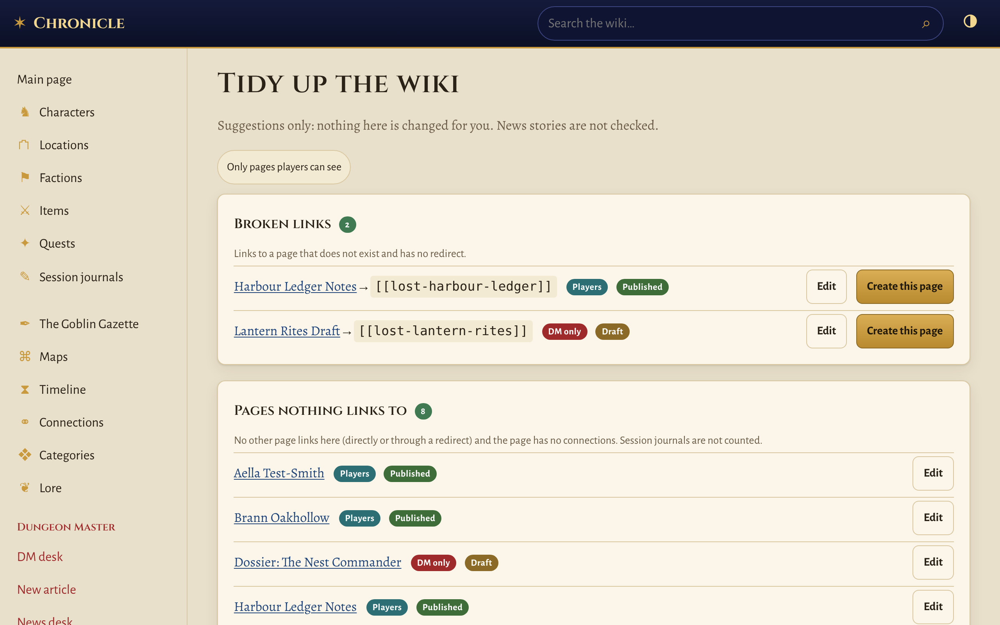

# Chronicle website features (November 2026 sprint)

This page explains two features added during the November 2026 sprint: the picture viewer, which everyone can use, and the wiki tidy-up report, which only the DM can open.

## A. Picture viewer (players and DM)

On any wiki page, click a picture (or press Enter while it is selected) to open it full screen.

- **Moving between pictures:** the viewer steps through every picture on that page, in order. Use the Previous and Next buttons, the Left and Right arrow keys, or swipe on a phone.
- **What you see:** a counter such as "3 of 7", the caption, and the description (the alt text).
- **Open original:** opens the full-size file in a new tab.
- **Closing:** press Esc, press Close, or click outside the picture. You return to the picture you opened.
- **Only visible pictures:** the viewer includes only the pictures you can already see on the page. A player never sees a DM-only picture, and it is not counted in the "of" total.
- **Phones:** Previous and Next sit under the picture.

**Limitation:** a picture link expires after 10 minutes. If the viewer stays open that long, close it and open it again.

### Tests

- **Picture viewer, unit:** 4 tests in `src/lib/lightbox.test.ts`.
- **Picture viewer, browser:** `tests/e2e/lightbox.spec.ts` covers:
  - opening by click and by Enter;
  - the Previous and Next buttons;
  - the arrow keys and wrap-around;
  - Esc and Close, and focus returning to the picture;
  - the phone layout and touch swipe;
  - a player never seeing a DM-only picture.
- **Full-suite results:** see IMPLEMENTATION-STATUS.md

## B. Tidy up the wiki (DM only)

Open the DM desk and choose **Tidy up the wiki**, or go to `/dm/tidy`. The report shows five collapsible lists, each with a count:

1. **Broken links:** a wiki link to a page that does not exist and is not a redirect. "Create this page" opens the new-page form with the address and title already filled in.
2. **Pages nothing links to:** pages with no link from another page and no connection to anything. Sessions and Gazette stories are not listed.
3. **Missing summary:** pages with no summary.
4. **Missing picture:** characters, locations and factions with no main picture.
5. **Empty pages:** pages with no section that contains text.

Each row links to the page and to its editor, and shows whether players can see the page.

- **Only pages players can see:** narrows every list to published player pages.
- **Gazette stories:** left out of the report. Edit them on the news desk.
- **Read only:** the report changes nothing.
- **Players:** cannot open it.

### Tests

- **Unit tests:** `src/lib/wikiTidy.test.ts`.
- **Browser tests:** `tests/e2e/wiki-tidy.spec.ts` (2 tests). They cover the DM report, the filters, the create-page prefill, and the phone layout. A player sees nothing.
- **Full-suite results:** see IMPLEMENTATION-STATUS.md

## Technical notes

- No database migrations and no new dependencies.
- The picture viewer uses a native dialog. It registers only pictures whose signed link loaded.
- The tidy report loads ids and slugs in parallel paged queries. It never downloads section text.
- The new-page form accepts `?slug=` and `?title=` to prefill a draft. Nothing is saved until the DM saves.
